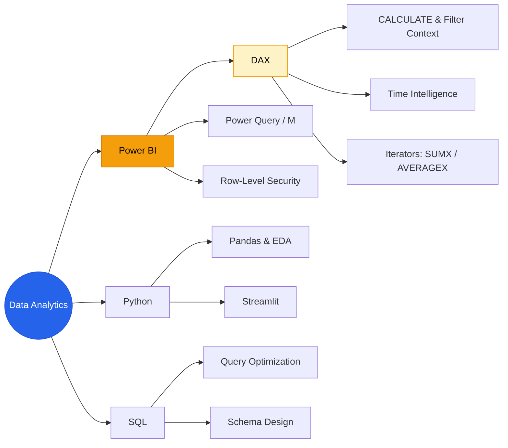

```text

                  ;,_            ,
                 _uP~"b          d"u,                     I am a recent B.Tech graduate in Data Analytics
                dP'   "b       ,d"  "o                      with hands-on experience and skills
               d"    , `b     d"'    "b                     in Power BI, SQL, Excel, and Python.
              l] [    " `l,  d"       lb
              Ol ?     "  "b`"=uoqo,_  "l
            ,dBb "b        "b,    `"~~TObup,_
          ,d" (db.`"         ""     "tbc,_ `~"Yuu,_
        .d" l`T'  '=                      ~     `""Yu,
      ,dO` gP,                           `u,   b,_  "b7
     d?' ,d" l,                           `"b,_ `~b  "1
   ,8i' dl   `l                 ,ggQOV",dbgq,._"  `l  lb
  .df' (O,    "             ,ggQY"~  , @@@@@d"bd~  `b "1
 .df'   `"           -=@QgpOY""     (b  @@@@P db    `Lp"b,
.d(                  _               "ko "=d_,Q`  ,_  "  "b,
Ql         .         `"qo,._          "tQo,_`""bo ;tb,    `"b,
qQ         |L           ~"QQQgggc,_.,dObc,opooO  `"~~";.   __,7,
qp         t\io,_           `~"TOOggQV""""        _,dg,_ =PIQHib.
`qp        `Q["tQQQo,_                          ,pl{QOP"'   7AFR`
  `         `tb  '""tQQQg,_             p" "b   `       .;-.`Vl'
             "Yb      `"tQOOo,__    _,edb    ` .__   /`/'|  |b;=;.__
                           `"tQQQOOOOP""`"\QV;qQObob"`-._`\_~~-._
                                """"    ._        /   | |oP"\_   ~\ ~\_~\
                                        `~"\ic,qggddOOP"|  |  ~\   `\~-._
                                          ,qP`"""|"   | `\ `;   `\   `\
                               _        _,p"     |    |   `\`;    |    |
       unknown                 "boo,._dP"       `\_  `\    `\|   `\   ;
                                 `"7tY~'            `\  `\    `|_   |
                                                      `~\  |

```

